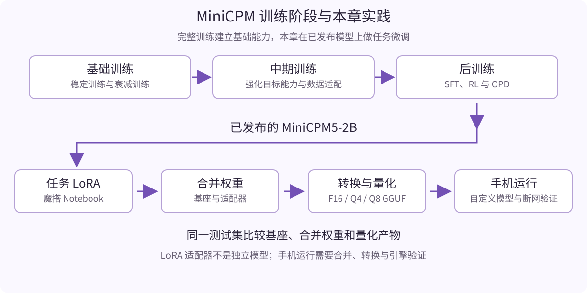

# 把自己微调的 MiniCPM 装进手机：从训练拆解到魔搭实践

一条随手记录往往同时包含事情、时间和补充说明。比如“工作：周五18点提交项目报告；另外需要浇花”，如果能在手机上直接整理成待办，就不必再逐项复制到表单。本章以这个小任务为例，先理解 MiniCPM 小模型怎样获得能力，再在魔搭 Notebook 中完成 LoRA 微调，把产物上传到自己的魔搭模型仓库，最后让手机下载并在本地运行。

完成本章后，你应当拥有三项成果：一份能追溯到基座与数据版本的微调模型、一份微调前后与量化后的对照结果，以及一台能够断网运行自己模型的 Android 手机。

> 本稿是共建章节初稿。配套数据生成、字段校验与业务示例已在本次环境验证；GPU 训练、权重转换、Android 编译及实机推理还需按文中步骤验收。性能与效果表保留待测状态。

## 1. 先定义一个适合手机的小任务

本章把任务限制为“从记录中抽取明确且尚未完成的待办”。模型不安排日程、不连接日历，也不推算用户没有提供的信息。输入是一段文字，输出只有以下结构：

```json
{
  "tasks": [
    {"task": "提交项目报告", "due_text": "周五18点", "category": "工作"},
    {"task": "浇花", "due_text": null, "category": null}
  ]
}
```

`task` 使用原文中的动作短语；`due_text` 保留原文时间，不把“周五”转换成绝对日期；`category` 只在原文明示“工作、生活、学习、其他”时填写，否则为 `null`。多件事按出现顺序排列，已经完成或取消的事不列入待办，没有待办时返回 `{"tasks":[]}`。

保留原文时间能减少一个常见错误：记录里有“明天”，但模型并不知道这条记录是在什么时区、什么日期写的。如果以后要接入日历，应由应用携带记录时间和时区，单独完成时间解析和用户确认。

任务边界确定之后，先用相同提示词测试基座。如果它已经满足你的需求，仍可完成本章实验，观察微调是否带来稳定性提升；实际项目则可以优先保留成本更低的方案。

## 2. 一个 MiniCPM 小模型是怎样训练出来的



我们使用 **MiniCPM5-2B** 作为文本模型。它采用标准 `LlamaForCausalLM` 架构，官方公开了 Base、Midtrain、SFT 和最终模型等阶段产物，适合观察训练阶段之间的关系。本章在最终模型上继续做任务微调，主模型入口是 [魔搭 MiniCPM5-2B](https://www.modelscope.cn/models/OpenBMB/MiniCPM5-2B)。

### 2.1 小模型需要在能力与运行成本之间取舍

手机需要同时为系统、应用、模型权重、KV cache 和临时计算张量保留内存。选择小模型的目的，是在资源约束下完成指定任务。模型小并不意味着任何任务都容易；输入复杂程度、输出长度、量化精度和运行引擎都会影响最终体验。

MiniCPM5-2B 的公开结构为 42 层、16 个 Query heads、2 个 KV heads，采用 GQA。它的总参数量为 **2,516,756,480**，非嵌入参数为 **1,981,982,720**。“2B”是模型名称中的规模标签，计算部署体积时应依据真实参数量和文件。仅将全量权重按每参数 2 字节估算，就约为 5.03 GB；这还没有包括运行时内存。本章从较短输入与较短 JSON 输出开始，不把模型公开的长上下文能力直接当成手机可以使用的上下文长度。

### 2.2 预训练、中期训练与后训练分别解决什么问题

| 阶段 | 输入与学习目标 | MiniCPM5 公开训练路线中的作用 |
| --- | --- | --- |
| 基础训练 | 大规模文本，预测后续 token | 建立语言与基础知识能力；训练路线包含稳定训练和衰减训练 |
| 中期训练 | 目标能力相关的数据 | 加强代码、数学等能力，适应目标数据分布 |
| 监督微调 SFT | 对话或任务输入与示范回答 | 学习指令遵循、回答方式及特定任务行为 |
| 强化学习 RL | 对生成结果的奖励反馈 | 进一步优化有评价信号的任务表现 |
| On-Policy Distillation | 教师对学生生成行为提供训练信号 | 将经过专门训练的教师能力蒸馏到发布模型 |

官方发布的 UltraData 系列覆盖网页、代码、数学、SFT 和 RL 等数据方向。对读者来说，值得学习的是数据质量与训练阶段如何相互配合，而不是把全部训练语料搬进一次 Notebook 实验。完整预训练需要远超本章的资源；本章只更新已有模型上的少量 LoRA 参数。

这里的“教师能力蒸馏”与部署时按 token 选择专家的 MoE 结构是不同机制。不要将训练阶段的专家教师理解成手机推理时需要同时加载的多个模型。

### 2.3 LoRA 怎样让模型学会我们的任务

LoRA 冻结基座权重，为指定线性层加入可训练的低秩更新。一次微调结束后得到的是适配器，它依赖原来的基座，不能当作完整模型独立运行。为了让手机使用，本章会把适配器合并回基座，再转换为 GGUF 并量化。

数据中的 `user` 给出记录，`assistant` 给出符合契约的 JSON。训练学习的是如何处理这些输入及如何输出，不是让模型增加确定可靠的私人知识。特别是“没有时间就填 null”“已经完成的不列入待办”等规则，需要在样例中反复体现。

## 3. 在魔搭 Notebook 中准备环境和数据

下载并解压配套实践包，在魔搭 Notebook 中上传整个 `minicpm-purplebook-draft` 目录，打开 `notebooks/01_minicpm5_todo_lora.ipynb`。Notebook 的路径检查会确认章节、脚本与数据位于同一项目根目录。

本章以 Python 3.11 和支持 BF16 的 NVIDIA GPU 为训练环境候选，建议准备 **24 GB 显存和至少 30 GB 可用磁盘**。这是给初次复现留余量的资源建议，尚不是实测最低需求。最终应记录实际 Notebook 镜像、GPU 型号、峰值显存、磁盘占用和训练时长。选择运行镜像与创建实例，可参考紫皮书第 04、10 章；额度和可获得资源以账号当时显示为准。

### 3.1 对齐模型、模板和依赖

官方微调文档区分了两个模板：

| 模型 | 模板 | 官方文档给出的 ms-swift 要求 |
| --- | --- | --- |
| MiniCPM5-1B | `minicpm5` | PyPI `4.5.3` |
| MiniCPM5-2B | `minicpm5_2b` | `>=4.6.0.dev0`，文档提供固定源码提交 |

本章使用 2B 模型，采用官方文档指定的 ms-swift 源码版本：

```bash
python -m pip install \
  'git+https://github.com/modelscope/ms-swift.git@654e24f17b5d9f40ed4b9ee4c56a723320244db5' \
  'transformers==5.7.0' 'modelscope==1.33.0' accelerate peft
```

保留 Notebook 镜像提供的匹配 CUDA 的 PyTorch。安装完成后重启内核，记录 `pip freeze` 和 GPU 信息。上述组合是基于官方兼容范围选定的初稿配置，需要在最终训练镜像中确认；不应把安装命令本身当成兼容性验证。

### 3.2 从魔搭下载基座，固定版本

```python
from modelscope import snapshot_download

base_dir = snapshot_download(
    "OpenBMB/MiniCPM5-2B",
    revision="master",
    local_dir="models/minicpm5-2b"
)
```

`master` 用于第一次发现当前产物。正式复现时，应在模型页选定实际存在的固定版本或提交，替换 `revision`，并记录配置、分词器和权重文件的 SHA256。Notebook 会生成文件清单，之后训练与评测全部使用下载到的本地路径。

不能用“今天下载的模型”作为长期复现标识，也不能只固定权重、不固定分词器。

### 3.3 准备训练、验证和测试数据

配套包提供原创合成教学数据：训练集 320 条、验证集 64 条、测试集 96 条。三个集合使用不同的外围表述模板，并检查原始输入不重复。它们包含单事项、多事项、取消、已完成、无待办、无关时间以及记录内要求改变输出格式的备注。

```bash
python examples/build_data.py
```

训练文件采用 ms-swift 支持的 messages JSONL，每行一个完整对话：

```json
{"messages":[{"role":"system","content":"按本章待办契约输出JSON。"},{"role":"user","content":"工作：周五18点提交项目报告"},{"role":"assistant","content":"{\"tasks\":[{\"task\":\"提交项目报告\",\"due_text\":\"周五18点\",\"category\":\"工作\"}]}"}]}
```

上例缩短了系统提示，实际文件包含 `examples/task_contract.py` 中的完整提示。训练、验证、测试和手机任务应使用同一契约。

合成数据适合教会读者跑通流程。虽然表述模板分离，但任务词汇与生成规则仍有共享，它不能证明模型已适应真实用户的全部记录。项目验收还应补充经过授权、人工标注且未参与调参的真实测试集。验证集用于调整参数和挑选检查点；最终测试集不用于选择提示词或学习率。

数据集托管时，将输入、标签、划分方法、生成脚本、版本和许可一同发布到魔搭数据集仓库。正文定稿前补上双方实际创建的仓库链接，配套包中的本地文件即可先用于初稿复现。

## 4. 用 ms-swift 完成一次 LoRA 微调

在项目根目录执行：

```bash
CUDA_VISIBLE_DEVICES=0 swift sft \
  --model models/minicpm5-2b \
  --model_type llama --template minicpm5_2b \
  --tuner_type lora \
  --dataset data/train.jsonl --val_dataset data/dev.jsonl \
  --target_modules q_proj k_proj v_proj o_proj gate_proj up_proj down_proj \
  --lora_rank 16 --lora_alpha 32 --lora_dropout 0.05 \
  --num_train_epochs 2 --learning_rate 1e-4 --warmup_ratio 0.05 \
  --per_device_train_batch_size 1 --per_device_eval_batch_size 1 \
  --gradient_accumulation_steps 8 \
  --max_length 512 --gradient_checkpointing true --bf16 true \
  --eval_strategy steps --eval_steps 20 \
  --save_strategy steps --save_steps 20 --save_total_limit 2 \
  --logging_steps 5 --seed 47 \
  --output_dir runs/todo
```

`--model_type llama` 负责选择模型加载类型，`--template minicpm5_2b` 负责选择对话模板，二者缺一可能导致自动匹配错误。SFT 样本中的 assistant 没有思考内容，固定版本的模板默认会为这类样本加入非思考前缀；`enable_thinking` 是推理选项，不应把它当成控制训练标签的方法。

| 参数 | 本章初始值 | 调整时观察什么 |
| --- | --- | --- |
| 学习率 | `1e-4` | 太大可能破坏输出行为，太小可能学习不足；用验证集判断 |
| 训练轮数 | `2` | 训练损失下降而验证结果恶化，可能过拟合 |
| LoRA rank / alpha | `16 / 32` | 控制更新容量与缩放，优先保持官方示例量级 |
| 单卡 batch / 累积步数 | `1 / 8` | 单卡有效 batch 为 8；先用小 batch 控制显存 |
| 最大长度 | `512` | 应覆盖完整提示、记录和答案；统计实际模板化长度，避免丢样本 |

LoRA 仍需加载基座，所以不会消除基座权重、激活和 KV 等开销。遇到 OOM，先确认其他进程、样本长度、batch 和数据是否异常，再考虑低资源路线。更换为 1B 时应同时换模型、模板、手机注册项和评测标识。

训练日志中需要确认：损失不是 NaN、实际处理的样本数正确、验证按预期运行、检查点保存了适配器。正常训练结束只是产物生成成功，不能据此认定任务效果已经提高。

## 5. 比较基座、微调和量化后的结果

先测试基座，再测试合并权重，最后测试 GGUF。比较时使用同一测试集、系统提示、输出上限和非思考模式。为便于对照，本实验采用确定性解码；这是任务评测协议，不是对 MiniCPM 所有推理场景的采样推荐。

```bash
python examples/predict_todo.py \
  --model models/minicpm5-2b --out results/base.jsonl

python examples/evaluate_todo.py \
  --predictions results/base.jsonl --report results/base-report.json
```

微调模型需要先合并。将 `--adapters` 替换为训练实际输出的检查点路径，示例中的 `checkpoint-实际步数` 不可原样执行：

```bash
swift export \
  --model models/minicpm5-2b \
  --model_type llama --template minicpm5_2b \
  --adapters runs/todo/实际运行目录/checkpoint-实际步数 \
  --merge_lora true --output_dir artifacts/todo-merged

python examples/predict_todo.py \
  --model artifacts/todo-merged --out results/merged.jsonl

python examples/evaluate_todo.py \
  --predictions results/merged.jsonl --report results/merged-report.json
```

配套 Notebook 会列出实际检查点并允许选择，避免把示例路径当成已生成的文件。

| 指标 | 定义 | 基座 | 合并权重 | Q4 GGUF |
| --- | --- | --- | --- | --- |
| 结构合法率 | 原始输出能直接解析且字段、类型满足契约的样本比例 | 待测 | 待测 | 待测 |
| 整条记录正确率 | 解析结果与标准答案完全相同的样本比例 | 待测 | 待测 | 待测 |
| 事项数量准确率 | 正确提取事项数量且输出结构合法的样本比例 | 待测 | 待测 | 待测 |
| 字段准确率 | 按事项顺序比较三个字段，多项或少项均扣分 | 待测 | 待测 | 待测 |
| 缺失信息保持率 | 标准答案应为 null 的字段仍输出 null 的比例 | 待测 | 待测 | 待测 |

无法解析的输出、超时和缺失预测都计为失败；评分前不删除 Markdown、不修复 JSON、不补字段。空待办样本的字段评分按一个完整空记录计算，避免被统计时忽略。所有指标应同时报告样本数量与失败样例。

EvalScope 可以用 `general_qa` 组织这批测试数据和报告，入口为 `examples/qa_evalscope.py`。它的默认 BLEU、ROUGE 适合补充观察，却不能判断“时间是否凭空补全”“是否把取消事项当成待办”，因此本章以任务校验脚本为主要依据。通用评测原理可继续阅读紫皮书第 15 章。

实际项目还可以增加“基座加少量示例提示”的对照，判断收益来自微调还是提示改进。这一组应独立标记，不能混入同提示词的主对照。

## 6. 转换、量化，并再次验证

GGUF 是模型文件格式，Q4_K_M、Q8_0 是量化方案。已经训练好的 LoRA 适配器应先合并到完整权重，不能将适配器直接改名为 `.gguf`。MiniCPM5 是文本模型，不需要 `mmproj`。

在 Linux 转换环境中准备 llama.cpp。本初稿将下面的上游提交作为转换候选，需要与手机内置引擎共同验收：

```bash
git clone https://github.com/ggml-org/llama.cpp.git vendor/llama.cpp
git -C vendor/llama.cpp checkout 23b0202a189c44a54625aadcb37a946dd1d6278d
python -m pip install -r vendor/llama.cpp/requirements.txt
cmake -S vendor/llama.cpp -B vendor/llama.cpp/build \
  -DGGML_CUDA=OFF -DLLAMA_CURL=OFF -DCMAKE_BUILD_TYPE=Release
cmake --build vendor/llama.cpp/build -j 4 \
  --target llama-quantize llama-cli llama-server

bash examples/convert_gguf.sh \
  artifacts/todo-merged artifacts/todo-gguf vendor/llama.cpp
```

脚本生成 F16、Q4_K_M、Q8_0 三份文件和校验清单。官方基座发布的 2B Q4_K_M 文件为约 1.56 GB，仅供存储规划参考；自己的产物大小应测量，文件体积不能代替运行内存。

先在电脑启动 Q4 服务，使用同一测试集检查转换与量化是否破坏模板、分词和任务效果：

```bash
vendor/llama.cpp/build/bin/llama-server \
  -m artifacts/todo-gguf/todo-Q4_K_M.gguf -a todo \
  --host 127.0.0.1 --port 8080 -c 2048 --jinja
```

在另一个终端运行：

```bash
python examples/predict_api.py --out results/q4.jsonl
python examples/evaluate_todo.py \
  --predictions results/q4.jsonl --report results/q4-report.json
```

服务必须实际支持 `enable_thinking=false`，并在对话模板中生成非思考前缀；以测试请求的真实表现和模板日志核对。若模板没有正确关闭思考，应修复模板或运行时配置，不通过截取思考内容掩盖问题。量化后退化明显时，检查分词器和模板一致性，再比较 Q8 与 F16，不能只用更强约束让 JSON “看上去正确”。

## 7. 上传到自己的魔搭模型仓库

为适配器、合并权重和手机 GGUF 分别建立仓库或明确区分目录。模型卡说明各自产物角色，并互相链接。

| 产物 | 是否可独立加载 | 模型卡应写明的关键内容 |
| --- | --- | --- |
| LoRA 适配器 | 否，需要对应基座 | 基座版本、LoRA 参数、训练数据及加载方法 |
| 合并权重 | 是，使用相应推理框架 | 合并来源、分词器、模板及评测结果 |
| 手机 GGUF | 需兼容的手机运行时 | 量化格式、转换提交、手机工程提交及校验和 |

在魔搭网页创建自己的模型仓库，把可分发文件放进独立发布目录，补上 README 模型卡和必要配置。上传脚本只接收这个目录，不应把训练工作区、账号凭据或私人记录一起上传。

```bash
python examples/upload_model.py \
  --repo 你的用户名/你的手机模型仓库 \
  --folder artifacts/todo-gguf \
  --revision cookbook-v0.1
```

这是一条需要读者填写自己仓库的示例命令。上传前在该目录准备 `README.md`；Token 在脚本运行时隐藏输入。上传后记录实际仓库链接与固定提交。`cookbook-v0.1` 只是发布分支示例，若后续更新，同名分支不再代表相同字节；手机注册最终应使用实际固定提交或不会覆盖的发布版本。

模型卡至少包含任务契约、基座与分词器版本、数据来源和许可、训练参数、环境清单、评测方法与失败案例、量化方式、手机要求及局限。模型、数据与教程各自的许可分别处理，不因为教程仓库采用 Apache-2.0 就自动改变所有材料的许可。

## 8. 在 Android 手机上运行自己的模型

主路线使用 OpenBMB 官方 [MiniCPM-V Apps](https://github.com/OpenBMB/MiniCPM-V-Apps)。虽然项目名称带 V，公开工程也支持 MiniCPM5-1B、MiniCPM5-2B 文本模型。

**官方预编译 APK 的模型列表是固定的。** 本章使用源码注册自己的 GGUF，再构建安装。它不是“把文件放入任意目录，官方 APK 就能识别”的通用导入方案。完成注册后，应用的 Model Manager 可以下载你的固定版本模型。

```bash
git clone https://github.com/OpenBMB/MiniCPM-V-Apps.git vendor/MiniCPM-V-Apps
git -C vendor/MiniCPM-V-Apps checkout d1aac05eecaac64b7fc35f1cc93a06b726ce10e3
git -C vendor/MiniCPM-V-Apps submodule update --init --recursive

python examples/register_android_model.py \
  --apps vendor/MiniCPM-V-Apps \
  --repo 你的用户名/你的手机模型仓库 \
  --revision 上传后的固定提交或发布版本 \
  --gguf artifacts/todo-gguf/todo-Q4_K_M.gguf
```

脚本在官方 `ModelInfo.kt` 的模型列表中增加一项，设置独立模型 ID、魔搭下载 URL 和文件校验值；同时在该自定义模型的加载与清空会话入口设置相同的待办系统提示和非思考模式。这里使用公开可下载仓库；私有仓库需要另外实现鉴权下载，本章不把账号 Token 打包进手机应用。

用 Android Studio 打开 `vendor/MiniCPM-V-Apps/MiniCPM-V-demo-Android`。所选工程声明 NDK `27.0.12077973`、CMake `4.1.2`、compile SDK 36.1，按实际 Gradle 提示安装匹配组件，在已配置 SDK 的环境构建：

```bash
cd vendor/MiniCPM-V-Apps/MiniCPM-V-demo-Android
./gradlew assembleDebug
adb install -r app/build/outputs/apk/debug/app-debug.apk
```

读者硬件范围先按官方安装页的 Android 8.0+、ARM64、建议至少 6 GB RAM 选择；具体手机能否运行以本章自定义模型的实测为准。源码声明的最低 API 与安装页存在差异，正文采用安装页更保守的范围，不据此承诺全部设备兼容。

手机上选择“我的 MiniCPM 待办助手”，完成模型下载并加载。注册脚本会使用 `task_contract.py` 中的提示生成 `TodoPrompts.kt`，并在该模型加载及清空会话后调用 `setSystemPrompt`。每条测试前清空会话，保持非思考模式。原版聊天界面没有这个任务契约；如果跳过脚本，只把契约粘贴为用户消息，属于不同提示条件，应另外标记结果。

下载完成后开启飞行模式，输入一条没有见过的新记录。成功验收应同时包括：能生成符合契约的结果、没有调用远程推理接口、模型文件来自自己微调后的固定版本。运行官方原版模型只能验证安装路线，不能替代对自定义产物的验证。

## 9. 记录手机体验与排查问题

| 实测项目 | 测量方法 | 结果 |
| --- | --- | --- |
| 机型、系统、可用内存 | 记录型号、系统版本与加载前可用内存 | 待测 |
| 首次加载时间 | 从点击加载到模型可接收输入 | 待测 |
| 首字延迟 | 从提交记录到第一个输出 token | 待测 |
| 完整待办生成时间 | 从提交到生成结束，包含提示处理 | 待测 |
| 解码速度 | 生成 token 数除以实际解码时间，注明 tokenizer | 待测 |
| 峰值内存 | 用系统工具采样进程内存，记录采样口径 | 待测 |
| 连续运行 | 固定输入长度连续 20 条，记录延迟、失败及发热 | 待测 |
| 断网推理 | 飞行模式下输入新记录并生成结果 | 待验收 |

不能将字符数当成 token 数，也不能把桌面 GGUF 服务速度当成手机速度。首字延迟与整条 JSON 完成时间同时报告，才能反映待办助手的真实交互成本。

模型导入失败时，检查文件完整性、GGUF 元数据、分词器与引擎提交；出现思考内容时，检查模板和非思考设置；内存不足时，降低上下文与输出上限、比较量化方案；格式退化时，从原始失败样例定位数据与契约问题。JSON 非法时应用应保留原文，允许重新生成或手动编辑，不能把错误结果直接写入日历。

本章的完成标准是：自己的魔搭仓库有可追溯的训练与部署产物，自己的受支持手机能够加载这个产物，断网将新的记录转换成待办。到这一步，微调、发布和端侧运行才连成同一个实践。

## 参考资料

- [MiniCPM 官方仓库：结构、阶段权重与训练路线](https://github.com/OpenBMB/MiniCPM/tree/316cfb1cea39f39cfa16b4f5703b77495c2340be)
- [官方 ms-swift 微调说明](https://github.com/OpenBMB/MiniCPM/blob/316cfb1cea39f39cfa16b4f5703b77495c2340be/docs/finetune/ms_swift.md)
- [官方 llama.cpp 部署与自定义 GGUF 转换说明](https://github.com/OpenBMB/MiniCPM/blob/316cfb1cea39f39cfa16b4f5703b77495c2340be/docs/deployment/llama_cpp.md)
- [MiniCPM-V Apps 固定工程版本](https://github.com/OpenBMB/MiniCPM-V-Apps/tree/d1aac05eecaac64b7fc35f1cc93a06b726ce10e3)
- [ms-swift 模板参数与训练标签说明](https://github.com/modelscope/ms-swift/blob/654e24f17b5d9f40ed4b9ee4c56a723320244db5/swift/arguments/base_args/template_args.py)
- [EvalScope 自定义问答数据说明](https://github.com/modelscope/evalscope/blob/3af6b5f0412a4eb88bc2dcd4308b2e0fe6713de1/docs/zh/advanced_guides/custom_dataset/llm.md)
