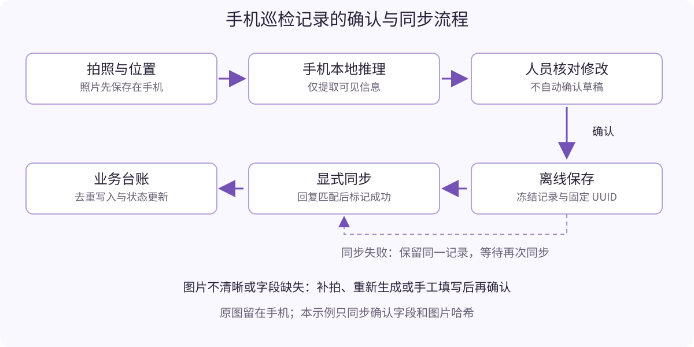

# 用 MiniCPM-V 搭建手机巡检助手：拍照生成现场记录

物业巡检人员走到二层东侧走廊，看到灯罩破损，拍下一张照片。在现场生成观察草稿，核对对象和现象，补充位置后保存；没有网络时继续巡查，有网络时再把确认过的记录同步到台账。这是本章要完成的工作流程。

手机在这里承担现场采集、模型运行、人工确认和离线保存。MiniCPM-V 根据图片提取可见信息，应用负责时间、位置和记录状态，台账承接后续处理。模型生成的是观察草稿，工作人员决定哪些内容可以成为正式记录。



> 本稿以合作方案中的物业巡检示例展开，尚不是已有落地案例的复盘。使用有公开手机工程的 MiniCPM-V 4.6 作为初稿基线；配套提供 Notebook 基线脚本、Android 巡检界面与集成脚本，以及可运行的模拟台账。2026-10-14–15 已在荣耀真机完成相机/相册生成、断网确认、显式同步与状态刷新，并补测20张公开裁剪图的连续运行。GPU v2两模式各20图与新目录、新虚拟环境复跑已完成，公开复现包和Notebook入口已发布。设备指标和失败样例见本章第7节；固定签名Release已补齐三项预处理测试；自然低质量场景与独立语义评审仍待补齐。

## 1. 把巡检需求变成明确的模型任务

首个版本只处理公共区域中可以拍到的表面现象，例如灯罩破损、地面散落物和墙面可见污迹。它不从照片确定电路是否损坏，也不决定是否需要停机、维修或更换设备。

假设照片中可见破损灯罩，用户输入位置“二层东侧走廊”，模型草稿的目标结构是：

```json
{
  "object": "灯罩",
  "visible_issue": "灯罩表面可见破损",
  "needs_retake": false,
  "missing_fields": []
}
```

这是期望输出示例，不是模型实测回答。若图片暗到无法确认，契约允许返回：

```json
{
  "object": null,
  "visible_issue": null,
  "needs_retake": true,
  "missing_fields": ["object", "visible_issue"]
}
```

`needs_retake` 只是一条模型建议，没有校准概率的含义。即使它为 false，也仍然需要人员查看照片与字段。清晰的正常场景可以描述“未见明显表面异常”，这表示照片范围内的观察，不等于设备整体正常。

### 字段来自哪里

| 字段 | 产生者 | 约束 |
| --- | --- | --- |
| 对象 object、可见现象 visible_issue | 模型提出、人员修改确认 | 只写有图像依据的信息；无法确认时留空 |
| 是否建议重拍、缺失字段 | 模型与应用校验 | 提醒用户补拍或补录；不作为诊断结论 |
| 拍摄时间 captured_at | 应用 | 保存带时区的时间；说明是否来自现场相机或相册导入 |
| 位置 location | 用户选择或输入 | 第一版不用模型猜测楼层，不把未经授权定位当成默认输入 |
| 记录 ID | 应用 | 创建后固定，重试同步仍使用同一 ID |
| 图片 SHA256、模型版本 | 应用 | 用于关联原始输入与推理产物 |
| 确认人、确认时间 | 人员操作与应用 | 只有点击确认后生成正式记录 |
| 处理状态、服务端版本 | 台账 | 待处理、处理中、已关闭，独立于模型草稿 |

位置先由用户输入，不把它交给模型生成，能避免照片里没有楼层信息却产生一个貌似完整的位置。拍摄时间也应来自业务应用，不依赖模型对“现在”的判断。

## 2. 先在 Notebook 中验证单图理解

模型入口为 [魔搭 MiniCPM-V 4.6](https://modelscope.cn/models/OpenBMB/MiniCPM-V-4.6)。它支持图像、视频与文本输入。本章只使用单张图片，不同时引入语音、视频流和工具调用。

从[公开Notebook复现入口](https://modelscope.cn/gallery/pzc163/minicpm-v-inspection-part5)点击“运行”，选择GPU实例和普通Python3内核，顺序执行。入口先下载并校验[公开复现包](https://modelscope.cn/datasets/pzc163/minicpm-v-inspection-part5)，再建立本目录虚拟环境；权重另行从官方固定提交下载。该流程已在新目录和新虚拟环境中完整复跑，官方模型缓存复用但重新校验，并未另开全新实例或重下载权重。

原配套 `notebooks/02_minicpmv_inspection_baseline.ipynb` 保留为官方示例基线模板；可替换成自己拥有使用权限的图片。模型代码采用官方的 Transformers 路线：

```bash
python -m pip install 'transformers==5.7.0' 'modelscope==1.33.0' \
  accelerate Pillow torchvision av
```

保留与 Notebook CUDA 相匹配的 PyTorch / torchvision 组合，避免为了一个单图实验升级整个 CUDA 软件栈。本次 A10 提示v2公开20图回归记录到的 PyTorch 显存分配峰值为16x约2645.7 MiB、4x约2739.4 MiB，属于分配器口径，不代表整卡驱动占用或其它输入的峰值。官方仓库根目录的旧 requirements 包含早期模型依赖，不应直接替代 4.6 对应的推理说明。

配套 Notebook 使用模型仓库的完整 Git 提交固定文件。2026-10-14 验证时，仓库没有发布版本标签，`modelscope==1.33.0` 的 `snapshot_download` 不接受该仓库的提交哈希；配套 `download_vision_model.py` 改用接受固定提交的文件接口，并逐文件校验 SHA256、保存下载清单。已核对的提交为 `fd02313ad21ac485c595cb01231a3bded449cff5`：

```bash
python examples/download_vision_model.py \
  --revision fd02313ad21ac485c595cb01231a3bded449cff5 \
  --out models/minicpm-v-4.6
```

运行下载单元格或以上命令后，使用配套推理脚本：

```bash
python examples/vision_baseline.py \
  --model models/minicpm-v-4.6 \
  --image 自己的现场照片.jpg \
  --downsample 16x \
  --out results/inspection-one.json
```

脚本的核心调用如下：

```python
inputs = processor.apply_chat_template(
    messages, tokenize=True, add_generation_prompt=True,
    enable_thinking=False, return_dict=True, return_tensors="pt",
    downsample_mode="16x", max_slice_nums=1
).to(model.device)

generated_ids = model.generate(
    **inputs, downsample_mode="16x",
    do_sample=False, max_new_tokens=384
)
```

使用与当前模型匹配的 `AutoProcessor`、`AutoModelForImageTextToText` 和系统提示。`downsample_mode` 必须在预处理和生成两处保持一致，否则图像占位与视觉特征可能不匹配。

16x 与 4x 是精度和计算开销的取舍，不能用一般性的“更快”承诺替代具体巡检图片测试。初始设置 `max_slice_nums=1` 是为了限制资源；细小文字、远处裂痕或大场景可能需要增加切片、改用 4x 或重新近距离拍摄。手机工程使用自己的视觉处理接口，不应把 Notebook 的参数名直接假定为手机中同名设置。

配套Python脚本现采用v2短提示，要求填写可见对象或表面，移除长提示中的空值示例；严格解析规则不变。Android v23仍保留已验收的v1提示，两者版本不能混淆。公开复现包的 `notebooks/part5_reproduce.ipynb` 使用普通Python3内核，从新目录新建推理虚拟环境，另行下载并校验官方模型。

脚本同时保存原始回答和结构校验结果。合法 JSON 只证明结构满足要求，是否看对图片需要人工标注与核对。如果原始输出不合法，保留错误，允许重新生成或手工填写，不将非法输出“修一下”后计为识别成功。

## 3. 组织现场图片与标准记录

首轮至少覆盖清晰、暗光、模糊、遮挡、正常场景和缺少位置的输入。样本使用自己拍摄且可公开的照片，或已有明确授权的图片；配套包未附带真实巡检照片，不能把 JSON 示例当成视觉测试集。

为每张图片建立标注记录：

```json
{
  "sample_id": "inspection-001",
  "image": "images/inspection-001.jpg",
  "location_input": "二层东侧走廊",
  "acceptable_objects": ["灯罩"],
  "required_observations": ["可见破损"],
  "unsupported_claims": ["电路故障", "必须更换整灯"],
  "quality_group": "clear",
  "source": "自有拍摄并获授权",
  "license": "由图片作者填写实际许可"
}
```

同一处对象连拍的照片应属于同一划分，不能一张调试、一张最终测试，以免把相近图片重复算成泛化能力。标准答案允许必要的同义表述，语义准确率由人工或明确规则判定；只有固定字段和类型适合完全自动校验。

将可公开的图片、标注、许可与划分说明上传魔搭数据集仓库，Notebook 先从这个数据版本下载。真实业务照片可继续保留在设备上，不需要为了托管教学资产公开客户现场资料。

## 4. 让真实手机完成图像推理

主路线复用 [MiniCPM-V Apps 的 Android 工程](https://github.com/OpenBMB/MiniCPM-V-Apps/tree/d1aac05eecaac64b7fc35f1cc93a06b726ce10e3)。先安装官方 Demo，选择 MiniCPM-V 4.6，下载相匹配的语言模型 GGUF 与视觉投影文件 `mmproj-model-f16.gguf`。视觉组件缺失、版本不匹配或加载失败时，文本模型能回答问题不代表图像推理已经工作。

本章在移动端优先复用官方发布且被该工程支持的模型包，不自行重做视觉转换。把下载来源、固定版本、两个文件的哈希与应用提交记录到部署清单。若要重新转换视觉模型，须使用模型团队确认的转换器与投影配置，再重新做实机验收，不能沿用文本模型的单文件转换脚本。

进行业务界面开发时，克隆并固定工程：

```bash
git clone https://github.com/OpenBMB/MiniCPM-V-Apps.git vendor/MiniCPM-V-Apps
git -C vendor/MiniCPM-V-Apps checkout d1aac05eecaac64b7fc35f1cc93a06b726ce10e3
git -C vendor/MiniCPM-V-Apps submodule update --init --recursive
```

运行配套集成脚本，加入巡检 Activity、生成与记录组件、设备测试和必要的原生修复，再构建测试 APK：

```bash
python examples/integrate_inspection_android.py --upstream vendor/MiniCPM-V-Apps
cd vendor/MiniCPM-V-Apps/MiniCPM-V-demo-Android
./gradlew assembleDebug assembleDebugAndroidTest
```

实际工程使用 SDK 36.1、Build Tools 36.0.0、NDK 27.0.12077973 和 CMake 4.1.2。测试包名为 `com.example.minicpm_v_demo.inspection`，桌面显示“MiniCPM-V 实践版”，沿用原图标和唯一的 `MainActivity` 主入口，可以与官方 Demo 共存。主界面保留聊天、图片/视频输入、模型管理与下载，巡检通过“巡检助手 · 拍照记录”进入，不能用巡检页取代整个 App。没有模型的新用户仍可从原下载引导和模型管理准备权重；巡检页也提供模型管理与下载、返回主界面的按钮。更新同包名、同签名 APK 可保留私有模型、照片、草稿与记录。

另提供基于同一v23功能源码的固定签名Release安装包：[MiniCPM-V-demo-Android-v2.5.apk](https://modelscope.cn/datasets/pzc163/minicpm-v-inspection-part5/resolve/master/MiniCPM-V-demo-Android-v2.5.apk?view=false)，21137824字节，SHA256为 `6615b7de73245a2dde9f45dae12da46298fe46bc97022a24329213afedba1283`。正式实践包名为 `com.example.minicpm_v_demo.practice`，桌面“MiniCPM-V 巡检实践版”，与上述Debug验证包及官方App共存。固定证书SHA256为 `3eddc4d89ab27dc97302e839da128905e71779c276cd34c79e2aded29e230791`；原MainActivity为唯一入口，Release不可调试，APK内保留许可全文，不含模型权重、私钥或测试组件。

[安装说明](https://modelscope.cn/datasets/pzc163/minicpm-v-inspection-part5/resolve/master/APK-INSTALL.md?view=false)和 [Android源码/验收补充包](https://modelscope.cn/datasets/pzc163/minicpm-v-inspection-part5/resolve/master/part5-apk-v23-source.zip?view=false)另行提供。补充包是原创模块、增量patch和构建脚本，需要配合固定上游工程；原GPU复现ZIP及其SHA256保持不变。独立包不会自动迁移旧验证包照片和正式记录；后续同包名更新须保持固定签名并递增版本号。


配套 `android/patches/0002-inspection-module-entry.patch` 增加模块入口，集成脚本可重复执行。巡检 Activity 使用独立的 `:inspection` 进程，`InspectionModelContext` 将模型偏好保存到 `inspection_model_prefs`，共享原模型文件目录。巡检的清空上下文、固定 4.6、切片1和关闭思考仅作用于巡检会话，避免覆盖聊天设置。返回时卸载巡检模型；同时保留两个会话会增加内存，Android 在内存压力下仍可能回收后台聊天进程，需要在目标手机验证。

固定 Apps 提交的 Android 系统提示词路径存在兼容问题：4.6 的 Jinja 模板不能单独格式化只有 system 的消息，未捕获的 C++ 异常会导致 SIGABRT 闪退。配套 `android/patches/0001-minicpmv-system-prompt.patch` 将视觉路径的 system 提示词按该工程 iOS 路径使用的 ChatML 格式送入模型，并把提示词处理中的 C++ 异常转为 Java 错误。集成脚本会自动应用补丁；还修正了清空上下文时丢失 8192 上下文配置的问题。此修复必须经过实际照片生成复测，编译通过不能代替真机验证。

官方引擎提供的调用链是：

```kotlin
engine.setEnableThinking(false)
engine.clearContext()
engine.setSystemPrompt(InspectionContract.PROMPT)
engine.prefillImage(jpegBytes)
engine.sendUserPrompt(InspectionContract.PROMPT, predictLength = 384)
```

四字段约束同时写入 system 与 user 提示，明确只描述一个主要对象，并规定 `missing_fields` 必须为数组；手机初测仅有笼统的 user 问题时曾返回多个对象或 null 缺失列表。提示词改进不保证每张照片都合格，仍需保留严格解析与人工核对。

实际代码由 `InspectionRunner.generate` 收集流式结果后进行解析。它要求模型和视觉组件已经加载，并用互斥锁保证同一引擎不会同时处理两张图片。每条巡检先清除历史上下文，避免上一处设备的观察混入下一条记录。

`isVisionSupported` 必须为 true 才能进入业务推理。当前工程在视觉组件加载失败时可能继续文本模式，因此业务层要明确拦截这一状态。

## 5. 从 Demo 变成现场工作界面

第一版界面可以由“采集、草稿确认、记录列表”三个页面组成。按照顺序实现以下行为：

1. 调用相机或选择相册图片，立刻复制到应用私有文件目录并建立草稿 ID。保留原图，推理使用校正 EXIF 方向后的 JPEG 副本；显示预览并提供重拍。
2. 用户选择位置。现场拍照记录应用采集时间；相册导入保留导入来源，照片时间未知时提示人员核对，不能把导入时间伪装成原始拍摄时间。
3. 点击生成后，显示模型加载、图片预处理和生成状态。先保证照片与输入已保存，再运行模型；失败或中断不能丢掉已拍照片。
4. 把模型对象与可见现象放进可编辑表单。JSON 非法、字段缺失或建议重拍时，展示相应提示，允许重拍或手工填写。
5. 用户核对图片、位置与观察后点击确认，生成冻结的正式记录，在一个本地数据库事务中保存记录与待同步状态。
6. 在记录列表明确区分“仅保存在手机”“同步成功”“同步失败”，点击同步按钮才发送确认过的记录。

照片处理时可先使用长边 1280 像素作为候选，而不是把大图不加限制地交给手机。应记录实际压缩参数，并用细小缺陷与暗光样例检查信息是否被压缩丢失。为防止重复推理和修改时错配，按钮状态、图片哈希与草稿 ID 应一起管理。

下面展示已加载引擎上的生成入口。`jpegBytes` 是上一步准备好的图片，`scope` 为页面生命周期作用域：

```kotlin
val runner = InspectionRunner(engine) // 页面保留同一个实例
scope.launch {
    try {
        val draft = runner.generate(jpegBytes)
        // 将字段绑定到可编辑表单；不在这里自动确认或同步。
        showEditableDraft(draft)
    } catch (e: Exception) {
        // 保存照片与位置，显示重新生成、重拍或手工填写入口。
        showGenerationFailure()
    }
}
```

`showEditableDraft`、`showGenerationFailure` 是界面事件示意；配套 `android/InspectionActivity.kt` 已提供实际按钮与页面流程。应在手机上逐项验收相机、相册、旋转恢复、图片预处理和确认同步操作；仅编译成功不能代表这些流程已经通过。

保存正式记录时，应用生成 UUID、图片哈希、确认人和确认时间，将人员核对后的观察写入 `InspectionRecordStore.saveConfirmed`。两项观察字段仍为空时，不进入同步队列；若人员选择手工填写，记录其实际确认动作。正式记录一旦确认不再原地改写，后续更正以新记录关联原记录，避免同步重试提交不同内容。

## 6. 实现离线保存和联网同步

手机本地数据库保存确认记录和待同步队列，图片仍在设备私有目录。本示例同步结构化观察、位置和图片哈希，不上传原图。哈希只能用于关联与校验，后台不能凭哈希查看照片；若业务需要查看照片，应另做由用户选择的附件上传并记录同步范围。

配套提供标准库实现的模拟台账：

```bash
python examples/ledger.py --bind 127.0.0.1 --port 8787 --db ledger.sqlite3
```

为了先学习业务链路，不依赖 GPU，在第二个终端用示例确认记录运行：

```bash
python examples/offline_queue.py add data/inspection_confirmed_example.json
python examples/offline_queue.py pending
python examples/offline_queue.py sync --url http://127.0.0.1:8787
```

这个 JSON 是教学夹具：图片哈希为占位值，模型版本标注 `teaching-fixture-no-inference`。这些命令验证保存、同步和接口，不验证视觉模型，也不证明手机部署。

手机连接时可使用 USB 调试的端口反向映射，让手机上的回环地址转发到电脑台账：

```bash
adb reverse tcp:8787 tcp:8787
```

为本地教学的 HTTP 连接在 Debug 构建配置相应的网络策略；正式服务使用 TLS 和业务账号鉴权。本地服务默认只监听电脑回环地址。应用中的同步操作需要在 IO 线程运行：

```kotlin
scope.launch {
    val result = withContext(Dispatchers.IO) {
        recordStore.syncPending("http://127.0.0.1:8787")
    }
    showSyncResults(result)
}
```

### 用记录 ID 防止重复提交

手机同步时不能假定“请求超时就意味着后台没有保存”。一种常见情况是后台已经写入，回复在传输中丢失。如果手机重新生成 ID 再提交，会出现两条相同记录。

本示例采用以下约定：同一正式记录始终使用同一 UUID；相同 ID、相同内容的重复 POST 返回已经存在的记录；相同 ID、不同内容返回 409 冲突。手机只有收到 200 或 201 且确认回复中的记录内容相同，才把队列项标为同步成功。超时、鉴权失败和冲突都保留待同步项。

| 接口 | 输入 | 行为 |
| --- | --- | --- |
| `POST /records` | 人工确认过的完整记录 | 新记录返回 201；相同内容重试返回 200；内容冲突返回 409 |
| `GET /records` | 无 | 返回台账列表与处理状态 |
| `GET /records/{record_id}` | 记录 ID | 返回该记录和当前服务端版本 |
| `PATCH /records/{record_id}/status` | `status`、`expected_version` | 更新状态并增加版本；旧版本更新返回 409 |

台账将处理状态保存在观察内容之外。后台从 `pending` 改为 `in_progress` 或 `closed` 时，不覆盖模型观察或人员确认字段。手机通过 `refreshStatus` 显式刷新处理结果。

可以先用 `GET /records` 找到实际 ID 和当前版本，再更新状态：

```bash
curl http://127.0.0.1:8787/records
curl -X PATCH \
  http://127.0.0.1:8787/records/e30ac04c-56d6-4c8e-b005-1d62c567e247/status \
  -H 'Content-Type: application/json' \
  -d '{"status":"closed","expected_version":1}'
```

上面的 UUID 只对应配套教学夹具，现场记录应使用手机生成的实际 ID。再读取台账或刷新手机状态，即可观察已关闭状态。模拟服务没有完整的人员组织、工单权限和生产审计功能，不能直接作为生产台账部署。

## 7. 分别验证识别效果、手机表现和业务闭环

三类验证回答不同问题：模型有没有看对、手机能不能稳定运行、记录有没有可靠地流转。任何一项成功都不能替代其余两项。

### 7.1 模型输出与人工修改

| 指标 | 统计口径 |
| --- | --- |
| 结构合法率 | 原始输出直接通过字段与类型校验的样本比例 |
| 对象准确率 | 与人工标注的可接受对象一致的比例，允许事先定义的同义词 |
| 可见现象准确率 | 描述符合照片可见证据的比例，由标注规则与人工审阅判断 |
| 无依据补充率 | 出现照片和输入不支持的物体、成因或处置断言的比例 |
| 人工修改率 | 需要修改对象或现象的草稿占比，保留修改前后内容 |
| 补拍与失败率 | 因模糊、暗光、字段缺失、推理中断等无法直接确认的比例 |

同一图片在 Notebook、手机原精度或量化版本中分别测试，确认差异来自哪一环。EvalScope 可组织自定义视觉问答数据与报告，业务字段和无依据补充仍需独立规则或人工评审；本初稿没有宣称已完成 EvalScope 视觉评测。

原始v1公开20图对照保留在 `results/part5-validation/comparison-20.csv`，每张图的SHA256在手机、16x、4x三组中一致，v1运行时提示文本哈希相同。A10两个模式各20次完成，但严格结构合法率均为0/20：所有回答的 `object` 为null而 `missing_fields` 为[]。手机v20为19/20合法。原始失败回答保留，不修正JSON后重新计分。

2026-10-15补测先用01、02、11三张图比较提示，旧长提示0/3合格，短提示3/3合格；随后固定 `inspection-v2-concise` 短提示完整重跑20图两模式。结构校验未放宽，也未用标注生成答案。提示SHA256为 `0c3fed70240a1639d25d0f6057972c46f9d21abf0925ce1fd19e038d51040fdb`。这是包含开发图片的回归，不是独立盲测。

| GPU v2指标 | 16x | 4x |
| --- | --- | --- |
| 严格结构合格 | 20/20 | 20/20 |
| 完整推理平均 | 1044.2 ms | 1055.1 ms |
| 中位数 | 998.9 ms | 997.2 ms |
| P95，线性插值 | 1118.6 ms | 1167.8 ms |
| PyTorch显存分配峰值 | 2645.7 MiB | 2739.4 MiB |
| 宽泛表面对象 | 19/20 | 16/20 |

40条回答和Notebook实际执行记录保存在 `results/part5-validation/notebook-public-batch-v2/`，复算结果与逐图核对在 `gpu-v2-summary/`。第5、6张仍未明确提出裂缝，第19张描述与源负类有分歧；4x还出现英文surface、具体地面猜测等。代理对照图片的核对不是独立专家盲评，不报告语义准确率。

Android v23仍用原v1长提示，SHA256为 `5cb203d55db7c862f7479ed64a7843c6beeef5a4cfb897ea1edbfa76efb5a4e1`。当前GPU v2与手机不是同提示量化对照。GPU首token ID与手机首个文本片段计时不同，两端预处理、采样、输出长度和后端也不同，不计算统一速度倍率。对象/现象准确率、无依据补充率及人员修改率仍需独立人工复核。

### 7.2 手机实际体验

| 项目 | 需记录的信息 | 本稿结果 |
| --- | --- | --- |
| 设备与部署 | 机型、系统、应用提交、模型与 mmproj 哈希 | HONOR WKL-AN80，Android 17/API 37，巡检助手 v20；模型哈希见部署清单 |
| 加载时间 | 新进程中的模型加载到视觉可用 | 连续测试加载3916 ms；此前实际 UI 加载2220 ms，均未清除系统文件缓存 |
| 首字延迟 | 图片读取、视觉编码和提示处理到首个文本片段 | 20图平均13166.8 ms，中位数13067.5 ms |
| 单条推理耗时 | 已准备 JPEG 到完整结构解析 | 平均21571 ms，中位数21765 ms，P95为27185 ms；不含相机/相册预处理和UI绘制 |
| 资源 | 进程内存、图片尺寸、切片与上下文配置 | 1秒采样峰值PSS 2393000 KiB，RSS高水位2513636 KiB；227×227，切片1，上下文8192 |
| 连续使用 | 单次加载后连续20张不同图 | 20/20返回原始回答、无闪退；19/20结构合法；电池温度40→42°C，全程充电，不计算耗电 |
| 飞行模式 | 新图片断网生成、确认并离线保存 | 实际断网新照片生成17575 ms，确认后入手机队列；恢复网络后显式同步为唯一记录 |

本次20图来自 [Concrete Crack Images for Classification v2](https://data.mendeley.com/datasets/5y9wdsg2zt/2)，作者 Çağlar Fırat Özgenel，CC BY 4.0。固定随机种子抽取裂纹/无裂纹各10张，图片与标注清单在 `data/inspection-validation/public-cracks/`。它们是227×227裁剪图，原场景分组未知，不能称为20个独立现场，也不能用此性能代表3072×4096相机采集流程。手机使用官方温度0.7采样，GPU基线采用确定性解码，差异不只来自量化。

手机第8张产生 `missing_fields:([])` 而被严格解析拒绝；第5张裂纹图只描述“wavy texture”，第19张来源负类图返回“has cracks”。结构合法率不等于观察准确率。另用有来源与参数记录的暗光、模糊、遮挡受控夹具分别测试两次，共6次仅1次结构合法，且重拍建议并不稳定；这些夹具不能替代自然低质量实拍。

相机预处理的8种EXIF方向、8192×6144大图缩放、非法图片拒绝，以及启动生成后的进程中断恢复已通过真机验证。后者核对照片、位置、时间、草稿ID保留，尚未单独声称流式输出中途断点续写。原始回答、资源采样和日志见 `results/part5-validation/`。

所有数字应来自真实手机、具体模型包和相同测试口径。云端 Notebook 只负责算法基线；手机浏览器访问云端页面也不能作为本地推理证明。

### 7.3 失败场景与流转可靠性

| 场景 | 正确行为 |
| --- | --- |
| 视觉组件加载失败 | 停止图像生成，显示组件错误，不继续伪装图像理解 |
| 模糊或暗光图片 | 提示补拍或手工填写，保留原图与位置 |
| 输出不是合法 JSON | 保留原始输出用于排查，表单不自动确认 |
| 生成期间应用中断 | 已采集照片与位置可以恢复 |
| 飞行模式确认记录 | 保存到本地队列，不等待网络请求 |
| 台账已写入但 ACK 丢失 | 用同一 ID 与内容重试，台账仍只有一条 |
| 同一 ID 内容发生变化 | 返回冲突，不覆盖已保存观察 |
| 两次后台状态更新冲突 | 用版本号发现冲突，刷新后再决定 |

配套 `examples/verify_local.py` 已验证 Python 校验与模拟业务链路，包括离线队列恢复、HTTP 同步、重复提交和版本冲突。这组本地检查不覆盖 Android 相机与 native 引擎；已执行的实机证据另保存在 `results/part5-validation/`。临时移开视觉组件的实际UI拦截、缺位置拒绝确认、v21生成开始时清除旧错误和中文缺字段提示均已通过，模型文件已恢复，两条正式记录没有改写。

模块化整改的 v22/v23 已恢复原主界面与模型下载。模拟空模型目录与默认偏好的启动可显示“去下载”，五个原模型仍可选择；该验证未实际重新下载权重，也不冒称全新安装测试。原聊天设置和会话在巡检生成后保留，正式记录和模型哈希不变。原 v20 的20图性能是历史单会话配置，不能直接充当整改后同时保留聊天与巡检两个会话的资源验收。

随后对独立.practice包完成真实首次安装：私有模型目录无GGUF、正式记录为0，通过原模型管理从魔搭下载4.6语言与视觉文件，并独立核对前文两份SHA256。原文字/图片聊天实际生成、五个模型与媒体/语音页面保留、巡检往返后聊天会话仍在；7项契约/SQLite及3项新版图片预处理设备测试通过。

固定签名Release的一张公开crack-01流程验收保存了两次回答：首次15.236秒输出非法 `missing_fields:[][]`，严格解析拦截且照片和字段保留，没有闪退；重试19.927秒输出合法四字段JSON，首文字7.986秒。对象仍为宽泛英文material，需要人工核对后修改。飞行模式开启、Wi-Fi关闭且无ADB反向网络映射时完成生成、本地确认及同步失败保留；恢复网络后显式同步成功、重复POST仍仅1条台账、服务端in_progress版本2刷新至手机。

这条记录明确标为公开测试夹具：原始拍摄时间未知，时间栏是导入测试值，确认人为apk-test-public-fixture，不代表真实现场。最终补入许可全文资产后，同版本同固定签名覆盖安装成功；共同功能文件逐字节相同，更新后再次核对模型哈希、记录内容和状态、冷启动及照片草稿恢复。没有把同版本重装当成未来版本递增升级测试。完整报告与未经修补的原始回答见补充包APK-VALIDATION.md及acceptance/acceptance-report.json。此结果不等于独立语义评审、自然低质量场景或完整语音/视频功能验收；其它机型与16KiB页尚未验证。


## 8. 魔搭平台怎样承接这些实践资产

| 平台能力 | 本章用途 | 应发布的资产 |
| --- | --- | --- |
| 模型库 | 提供固定基座、手机模型包与视觉组件 | 版本、文件哈希、部署说明 |
| 数据集 | 托管公开授权图片与人工标注 | 图片、标准记录、划分与许可 |
| Notebook | 验证单图理解与输出契约 | 可执行 Notebook、原始输出及配置 |
| EvalScope | 组织效果比较和报告 | 数据适配、评测配置与失败分析 |
| 创空间 Studio | 展示台账与教学样例 | 示例记录、接口说明、APK 下载与手机验收材料 |

创空间中的网页台账可以帮助读者理解流程。网页如果调用服务器模型，应明确标注云端体验；核心验收仍然是在手机断网状态下拍摄新图片并生成记录。第一版台账由开发者在本地运行，Studio演示仍为可选待办。本次已发布[第五章公开数据集复现包](https://modelscope.cn/datasets/pzc163/minicpm-v-inspection-part5)和[可运行Notebook作品](https://modelscope.cn/gallery/pzc163/minicpm-v-inspection-part5)。包SHA256为 `55fee5d70e416e310573c08a3a2739ad4482a4f590b298b7ca307d91d15670b5`，匿名下载已核对。数据CC BY 4.0、原创代码MIT，上游代码与模型保留各自许可。包不含私人照片、确认人、真实台账、模型权重或上游完整工程。新虚拟环境中的5个代码单元全部执行成功，40条原始输出与v2首次运行一致；执行产物另在仓库的 `part5-clean-room-results.zip` 中。

## 9. 升级到 MiniCPM-V 4.7 时保持任务契约

4.7 是后续可选的模型升级方向。升级前固定具体型号、正式模型页、语言权重、视觉组件、转换工具与手机引擎，不仅更换模型名称。相同巡检图片、相同标注与相同手机用于重新测量效果和资源成本。

可以按以下顺序迁移：先通过 Notebook 单图和结构输出，再通过手机单图理解与飞行模式推理，最后接回人工确认、离线队列与台账。是否采用 1B 或 35B-A3B 路线，由目标设备资源和端侧实测决定。不能将其他版本、其他机型或其他提示条件下的内存与速度数字直接写入本章。

最终完成标志是：另一位开发者能在受支持手机上拍摄一张新图片，断网生成草稿、人工确认并离线保存；联网后点击同步，在台账中看到唯一记录，再查看后续处理状态。模型文件、应用版本与实际手机指标应可以追溯。

## 参考资料

- [MiniCPM-V 官方图像推理说明](https://github.com/OpenBMB/MiniCPM-V#minicpm-v-46)
- [MiniCPM-V 4.6 模型页](https://modelscope.cn/models/OpenBMB/MiniCPM-V-4.6)
- [MiniCPM-V Apps 固定手机工程](https://github.com/OpenBMB/MiniCPM-V-Apps/tree/d1aac05eecaac64b7fc35f1cc93a06b726ce10e3)
- [Android LlamaEngine 图像预填充与推理接口](https://github.com/OpenBMB/MiniCPM-V-Apps/blob/d1aac05eecaac64b7fc35f1cc93a06b726ce10e3/MiniCPM-V-demo-Android/app/src/main/java/com/example/minicpm_v_demo/LlamaEngine.kt)
- [业务背景参考：PilotDeck 开发在线智能数据系统](https://modelbest.feishu.cn/wiki/Up4Owx87uiZLx0kFs3PcqjLYnch)，仅沿用合作方案列出的业务方向，不据此认定已有手机巡检实现。
